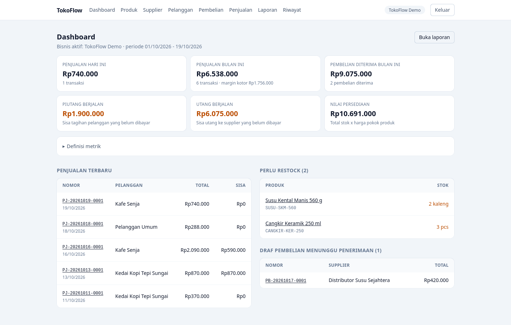

# TokoFlow

Aplikasi web untuk distributor dan reseller: kelola produk, supplier,
pelanggan, pembelian, persediaan, penjualan, pembayaran,
piutang/utang, laporan, dan jejak audit --- dengan alur transaksi yang
konsisten dan bisa diperiksa.

Dibangun dengan Laravel 13, MySQL 8, Blade, dan Tailwind CSS. Satu
instalasi melayani banyak bisnis (multi-tenant) dengan peran
owner/admin/staff yang diperiksa di sisi server.

<!-- Tangkapan layar: setelah ada gambar, aktifkan baris berikut.


-->

## Fitur

-   **Multi-bisnis & peran** --- satu pengguna bisa jadi owner di bisnis
    A dan staff di bisnis B; semua query dibatasi ke bisnis yang boleh
    diaksesnya.
-   **Data master** --- produk (SKU, harga jual, harga pokok default),
    supplier, dan pelanggan; penghapusan bersifat non-destruktif
    (menonaktifkan, bukan menghapus riwayat).
-   **Pembelian & penerimaan** --- draf pembelian dengan nomor unik
    `PB-YYYYMMDD-####`; stok bertambah hanya saat penerimaan
    dikonfirmasi, di dalam satu database transaction.
-   **Persediaan** --- setiap perubahan stok tercatat di buku besar
    `inventory_movements` (`balance_after`), penyesuaian manual wajib
    beralasan, dan stok negatif selalu ditolak.
-   **Penjualan** --- nomor `PJ-YYYYMMDD-####`, stok berkurang langsung,
    harga jual dan harga pokok disimpan sebagai snapshot sehingga
    perubahan harga produk tidak mengubah riwayat.
-   **Pembayaran, piutang, utang** --- pembayaran penuh/parsial untuk
    penjualan maupun pembelian, saldo selalu dihitung dari pembayaran
    aktif, pembayaran keliru dibatalkan lewat *void* (bukan dihapus).
-   **Pembatalan yang dapat ditelusuri** --- dokumen tidak dihapus;
    stok dikembalikan lewat pergerakan reversal dan ditolak total bila
    akan membuat stok negatif.
-   **Dashboard & laporan** --- penjualan, pembelian, stok, piutang, dan
    utang dari transaksi nyata, dengan rentang tanggal, penyaring
    "belum lunas", dan ekspor CSV.
-   **Jejak audit** --- pencatatan ringkas siapa melakukan apa, tanpa
    password/token, hanya-baca, dan bisa disaring per periode, jenis
    aktivitas, dan pelaku.
-   **Format Indonesia** --- input uang menerima `85.000` dan
    menampilkan `Rp85.000`; format angka dan tanggal sesuai kebiasaan
    lokal.

## Tumpukan teknologi

| Lapisan | Teknologi |
| --- | --- |
| Framework | Laravel 13 (Blade, tanpa starter kit) |
| Bahasa | PHP 8.4 |
| Database | MySQL 8 / InnoDB, `utf8mb4` |
| Frontend | Blade + Tailwind CSS 4 + Vite |
| Pengujian | PHPUnit |

## Menjalankan di lokal

Ringkasnya (prasyarat, pembuatan database, dan pemecahan masalah lengkap
ada di [`docs/deployment/local.md`](docs/deployment/local.md)):

```bash
git clone https://github.com/pecut-ai-id/toko.git tokoflow
cd tokoflow

composer install
cp .env.example .env
php artisan key:generate
npm install

# setelah database `tokoflow` dan `tokoflow_test` dibuat dan .env diisi
php artisan migrate --seed
npm run build
php artisan serve
```

Buka `http://127.0.0.1:8000` (root otomatis mengarah ke halaman login).

### Akun demo

| Peran | Email | Kata sandi |
| --- | --- | --- |
| Owner | `owner@tokoflow.test` | `password` |
| Staff | `staff@tokoflow.test` | `password` |

Akun ini dibuat oleh seeder dan hanya untuk mencoba aplikasi; ganti kata
sandinya sebelum dipakai dengan data sungguhan.

### Menjalankan tes

```bash
npm run build     # dibutuhkan karena beberapa tes merender halaman
php artisan test
```

Tes berjalan di database terpisah `tokoflow_test` (lihat `phpunit.xml`)
sehingga data development tidak tersentuh.

## Deploy ke VPS

Panduan lengkap Ubuntu 24.04 + nginx + PHP-FPM + MySQL, termasuk HTTPS,
backup, dan prosedur deploy ulang ada di
[`docs/deployment/vps.md`](docs/deployment/vps.md).

## Dokumentasi

| Dokumen | Isi |
| --- | --- |
| [`docs/requirements.md`](docs/requirements.md) | Kebutuhan produk dan kriteria penerimaan MVP |
| [`docs/architecture.md`](docs/architecture.md) | Model data, alur transaksi, peran, konvensi |
| [`docs/DECISIONS.md`](docs/DECISIONS.md) | Keputusan teknis beserta alasannya |
| [`docs/deployment/local.md`](docs/deployment/local.md) | Menjalankan di komputer lokal |
| [`docs/deployment/vps.md`](docs/deployment/vps.md) | Deploy ke VPS Ubuntu |

## Batasan yang diketahui

-   Pengembalian dana fisik tidak dicatat di aplikasi; pembayaran yang
    salah hanya di-*void*.
-   `products.cost_price` adalah harga beli terakhir yang valid, bukan
    rata-rata tertimbang.
-   Angka dashboard/laporan dihitung ulang setiap request (belum ada
    tabel ringkasan).
-   Ambang "stok menipis" masih konstanta kode (5), belum bisa diatur
    dari UI.
-   Jejak audit hanya berisi aktivitas setelah fitur audit dipasang dan
    belum punya kebijakan retensi.
-   Di luar cakupan MVP: multi-gudang, WhatsApp, AI di dalam aplikasi,
    payment gateway, aplikasi mobile native, dan akuntansi penuh.

## Lisensi

[MIT](LICENSE) --- © 2026 pecut.ai.id
